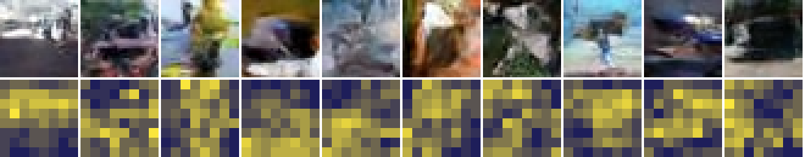

# HydroDiff

HydroDiff is an experimental image diffusion model built on top of the Hugging Face Transformers architecture.

The project explores compute-efficient image generation through a **predicted noise mask**, a **predicted update mask** that removes tokens from the computation, and a **mixture-of-experts denoiser**.

HydroDiff is designed to remain compatible with the Transformers ecosystem (`PreTrainedModel`, `save_pretrained`, `from_pretrained`) while adding dynamic computation to the sampler.

<!-- RESULTS -->

## Features

### Rectified-flow diffusion transformer

HydroDiff is a diffusion transformer that works directly on pixel patches:

* Rectified flow: `x_t = (1 - t) x_0 + t * noise`, trained on the velocity `noise - x_0`
* Logit-normal noise-level sampling
* Clean-patch prediction (`prediction_type="x"`), as recommended for pixel-space transformers
* Per-token adaLN-single modulation (one shared projection, a learned offset table per block)
* Axial 2D rotary positional embeddings (RoPE) and QK-norm
* Gated (SwiGLU) MLPs
* Class conditioning with classifier-free guidance
* Muon optimizer for the hidden weight matrices

### Per-token noise levels

Every patch token carries its **own** noise level `t` in `[0, 1]`.

The model is conditioned on each token's noise level through per-token modulation. During training, half of the images (`hetero_prob`) get tokens at different noise levels: from progress `hetero_start` on, each token gets a speed `r` between `1` and `max_rate`, so its progress is `q + (r - 1) * (q - hetero_start)`, where `q` is the progress of the image.

These are exactly the states that the adaptive sampler produces, so there is no gap between training and sampling. `hetero_start=0.25` matches the sampler's warmup: the tokens only separate once the image has some structure. This removes most of the accuracy that mixed-level training otherwise costs the plain sampler at high noise.

Tokens that are already clean (`t = 0`) are context, not targets: they take no part in the loss.

### Non-binary noise mask

At every sampling step the model **first predicts the noise mask**: the next noise level of every token. Each value is between `0` and `1`; values are not restricted to `0` or `1`.

The noise mask comes from an uncertainty head: a single linear layer that predicts the log mean squared error of each token's clean-patch estimate. It is trained with an exponential likelihood, so its output converges to the log of the expected error. The head reads detached features, so it does not change the denoiser.

The predicted uncertainty sets the speed of each token:

```text
uncertainty rank (0 = surest, 1 = least sure)
        │
        ▼
speed = max_rate ** (1 - rank)
        │
        ├── sure tokens (flat sky, smooth surfaces)
        │     move up to max_rate times faster and finish early
        │
        └── unsure tokens (fire, grain, dust, leaves, cracks)
              keep their noise longer, get every step,
              and are finished last against an already clean context
```

Unpredictable texture is therefore generated **after** the structure around it is known, which is the accuracy argument of the noise mask.

The uncertainty head does find that texture: its predicted error ranks against the high-frequency energy of the clean patch with a Spearman correlation of 0.67 at `t = 0.3` and 0.57 at `t = 0.6`, before the detail is visible. In generated images, sky and flat backgrounds finish first and objects and texture finish last:



The `churn` option is the second reading of "how much noise is applied where": it replaces a share of each token's noise with fresh noise in every step, scaled by the same uncertainty rank. It was measured and gives no gain (worse when strong), so it defaults to `0`.

### Binary update mask

After the noise mask, the model **predicts the update mask**: which tokens need to be computed in this step. Each value is `0` or `1`.

* A token that has reached `t = 0` leaves the update mask for good. Skipping it is exact, and the cached keys and values cost no measurable quality.
* With `reuse > 0`, a share of the surest moving tokens also skips the network in a step and moves with its estimate from the step before (never two steps in a row, never on its last step). `reuse=0.5` takes a third of the compute out of 32-step sampling at equal quality. `reuse_by="random"` picks the skipped tokens at random instead; at `reuse=0.5` that works as well, so most of the gain comes from skipping, not from which tokens skip.

The update mask is **not** applied by running the denoiser on every token and restoring the masked tokens afterwards. HydroDiff gathers only the tokens in the update mask and runs the transformer on those tokens only:

```text
All tokens
     │
     ▼
Update mask
     │
     ├── Masked tokens ──► not computed; their keys and values
     │                     come from a cache (attention context only)
     │
     └── Active tokens ──► gathered, run through every block,
                           scattered back
```

The attention queries come only from the active tokens; the keys and values come from the active tokens plus the cache. Every block, MLP and expert therefore processes fewer values.

### Mixture-of-experts denoiser

The MLPs can be fine-grained mixtures of experts with one always-on shared expert. Three routing modes are available:

| `moe_routing` | Who chooses the expert                                                     |
| ------------- | -------------------------------------------------------------------------- |
| `token`       | Every token, by sigmoid top-k affinity (auxiliary-loss-free balancing bias) |
| `image`       | The whole image, from the mean of its tokens, for one layer and one step   |
| `time`        | No router: each token goes to the expert of its own noise level           |

Because the update mask removes tokens before the blocks run, the experts only process the tokens that are active in the step.

At the scale tested (3M active parameters, CPU), the experts gave no measurable gain in accuracy or speed at equal active compute, and per-token routing makes single-image latency 57% worse. Dense MLPs (`num_experts=0`) are therefore the default; `time` routing (no router, no balancing, no latency cost) is the mode to try first at a larger scale.

### Samplers

`generate` supports:

* `solver="euler"`: first-order step on the clean-patch estimate (DDIM form)
* `solver="dpm2m"`: DPM-Solver++(2M), run **per token** so that every token uses its own step sizes
* `guidance_scale`: classifier-free guidance
* `adaptive`, `max_rate`, `warmup`: the noise mask
* `reuse`, `reuse_by`, `skip_finished`, `refresh_finished`: the update mask
* `churn`: per-token fresh noise

On this bench `euler` beats `dpm2m`, and the noise mask with `max_rate=3` keeps its quality at 32 steps for 12% less compute but hurts at 16 steps or fewer.

## Architecture

```text
              noisy patch tokens, one noise level per token
                               │
                               ▼
                   ┌───────────────────────┐
  noise mask ────► │      update mask      │ ──► masked tokens: key/value cache
                   └───────────┬───────────┘
                               │ active tokens only
                               ▼
                   ┌───────────────────────┐
                   │  HydroDiff blocks     │
                   │                       │
                   │  per-token adaLN      │
                   │  attention (2D RoPE)  │
                   │  MLP or experts       │
                   └───────────┬───────────┘
                               │
               ┌───────────────┴───────────────┐
               ▼                               ▼
       clean-patch estimate            uncertainty head
               │                               │
               ▼                               ▼
      per-token solver step         next noise mask and update mask
```

## Hugging Face Transformers Integration

HydroDiff implements Transformers-compatible model classes:

```python
HydroDiffPreTrainedModel
HydroDiffModel
HydroDiffForImageGeneration
```

HydroDiff also provides:

```python
register_hydrodiff_auto_classes()
```

This registers the model with `AutoConfig` and `AutoModel` so HydroDiff checkpoints using:

```text
model_type = "hydrodiff"
```

can be loaded through the standard Auto API.

## Model Outputs

### `HydroDiffOutput` (training)

| Field              | Description                                         |
| ------------------ | --------------------------------------------------- |
| `loss`             | Denoising loss plus the weighted uncertainty loss   |
| `denoise_loss`     | Velocity loss over the tokens that are not clean    |
| `uncertainty_loss` | Likelihood loss of the uncertainty head             |
| `prediction`       | Clean-patch (or velocity) prediction of every token |
| `timesteps`        | Per-token noise levels that were used               |

### `HydroDiffGenerationOutput` (sampling)

| Field          | Description                                                                 |
| -------------- | --------------------------------------------------------------------------- |
| `images`       | Generated images in `[-1, 1]`                                               |
| `compute`      | Token evaluations divided by `steps * tokens` (what a dense sampler spends) |
| `noise_masks`  | Noise level of every token after every step (`return_masks=True`)           |
| `update_masks` | Binary mask of the tokens computed in every step (`return_masks=True`)      |

## Training

```bash
python test/prepare_cifar10.py <CIFAR-10 image folders> /home/user/data
python test/train.py --preset hydrodiff-s --steps 4000 --out runs/base
python test/evaluate.py --ckpt runs/base/ema --n 5000 --gen steps=32
```

`--set key=value` overrides any configuration field. `test/evaluate.py` reports FID (InceptionV3), the sampling time per image and the compute of the sampler.

## Example

The repository includes `example_generate.py` for basic interactive generation.

Run:

```bash
python example_generate.py
```

The example loads a HydroDiff checkpoint, selects CUDA when available, and writes a grid of images for each CIFAR-10 class name that you type.

## Repository Structure

```text
HydroDiff/
├── hydrodiff/
│   ├── __init__.py
│   ├── configuration_hydrodiff.py
│   ├── modeling_hydrodiff.py
│   └── optimization_hydrodiff.py
├── test/
│   ├── RESEARCH.md
│   ├── prepare_cifar10.py
│   ├── train.py
│   └── evaluate.py
├── example_generate.py
├── LICENSE
└── README.md
```

## Research and Development

HydroDiff was developed through an AI-driven research and testing process.

All research and testing for the project was performed entirely by **Claude**, with minimal human interaction.

The human contribution was primarily to generate ideas and possible directions: the noise mask, the update mask and the mixture-of-experts denoiser.

The development process then followed an iterative loop:

```text
Human proposes an idea
        │
        ▼
Claude researches the idea
        │
        ▼
Claude determines how it could be implemented
        │
        ▼
Claude implements and tests it
        │
        ├───────────────┐
        │               │
        ▼               ▼
   Improves speed or   Does not
   accuracy            │
        │               ▼
        ▼          Drop or change the idea
   Keep and iterate
```

The measurements, the ideas that were kept and the ideas that were dropped are in [`test/RESEARCH.md`](test/RESEARCH.md).

## Project Status

HydroDiff is an experimental research project.

The architecture and implementation are subject to change as new ideas are tested.

The current implementation should therefore be treated as an experimental model architecture rather than a stable production API.
