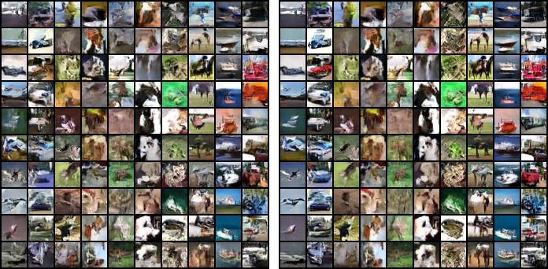
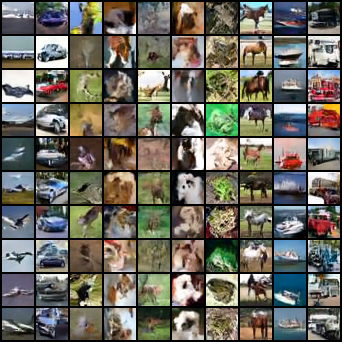
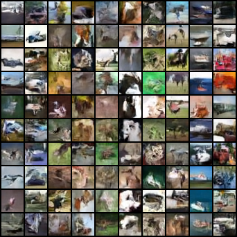

# HydroDiff

HydroDiff is an experimental image diffusion model built on top of the Hugging Face Transformers architecture.

The project explores compute-efficient image generation through a **predicted noise mask**, a **predicted update mask** that removes tokens from the computation, and a **mixture-of-experts denoiser**.

HydroDiff is designed to remain compatible with the Transformers ecosystem (`PreTrainedModel`, `save_pretrained`, `from_pretrained`) while adding dynamic computation to the sampler.

## Results

Every idea was measured on CIFAR-10 (32x32, class-conditional) with the 3M-parameter `hydrodiff-s`, trained on CPUs for 4,000 and 12,000 steps. Quality is FID against 10,000 training images; compute is the number of token evaluations relative to a dense sampler with the same steps. All tables are in [`test/RESEARCH.md`](test/RESEARCH.md).

| Idea | What was measured | Status |
| ---- | ----------------- | ------ |
| Non-binary noise mask (per-token noise level) | The uncertainty head finds unpredictable detail (Spearman 0.53-0.67 against high-frequency energy). It is level with or slightly better than the dense sampler for 11% less compute at 16 steps and 16% less at 32 steps (final model: 0.5 FID better on both seeds at 16 steps). On briefly trained models it was up to 2.3 FID better. It needs mixed-level training and enough steps per token. | Default |
| Binary update mask (only active tokens are computed) | Finished tokens are skipped exactly; the key/value cache costs no measurable quality. With `reuse`, 32-step sampling uses 29-36% less compute at the same quality with DPM-Solver (39-43% less wall-clock time); with Euler on longer-trained models it costs 0.5-2 FID. Choosing the skipped tokens at random works about as well as choosing the surest. | Default (finished tokens); `reuse` is an option |
| Mixture-of-experts denoiser | No accuracy or speed gain at equal active compute at this scale; per-token routing makes single-image latency 57% worse. | Option, off by default |
| Per-token fresh noise (`churn`) | No gain; worse when strong. | Dropped (default `0`) |
| `hetero_start` (new) | Starts mixed-level training at the sampler's warmup; removes most of what mixed-level training costs the plain sampler. | Default |
| Share of mixed images (`hetero_prob`) | 0.25 beat 0.5 by 0.6-1.4 FID in every sampler setting at 12,000 steps. | Default `0.25` |
| Classifier-free guidance on noise levels 0.2-0.85 | Scale 3 on that interval is about 8 FID better than no guidance (32.16 / 32.00 against 41.45 / 40.04) and 1 FID better than the best scale on all levels. CFG-Zero\*, leaving a block out of the unconditional pass (MOSS-Image) and autoguidance did not help. Costs a second model pass. | Default |
| Self-conditioning | The model gets its previous clean-image estimate as an input: 30.36 / 30.48 against 31.86 / 31.50 with the default guidance at 12,000 steps (level at 24,000 steps), free at sampling time. Contrastive flow matching (4 FID worse), a dispersive loss (15 FID worse), v-prediction and high-noise training (from MOSS-Image) did not help. Training twice as long gave 27.45 / 27.20. | Default in every preset |
| `min_token_steps` (new) | No token may take fewer steps than this (16 with Euler, 10 with DPM-Solver; `reuse` always keeps 16 evaluations); prevents the quality loss of fast tokens on too coarse a time grid. | Default |

### Final model

`hydrodiff-s` with the default configuration, trained for 12,000 steps (DPM-Solver; FID with 2,000 samples on two sampling seeds; speed measured alone on a 4-thread CPU, batches of 250):

| Sampler (DPM-Solver) | FID | Compute | ms / image |
| -------------------- | --- | ------- | ---------- |
| dense, 16 steps | 40.34 / 39.45 | 1.00 | 54 |
| **noise mask, 16 steps (default `generate()`)** | **39.87 / 38.91** | **0.89** | **47** |
| dense, 12 steps | 39.96 | 1.00 | 39 |
| dense, 32 steps | 41.61 | 1.00 | - |
| noise mask + `reuse=0.25`, 32 steps | 39.96 | 0.71 | - |

These numbers are without guidance. With the default guidance (scale 3 on noise levels 0.2-0.85) the same sampler gives **32.16 / 32.00** on the earlier final model (dense: 31.68), about 8 FID better, for about 2.4 times the time per image; `guidance_scale=1` turns it off (see [`test/RESEARCH.md`](test/RESEARCH.md), section 12).



### Image quality

What raised image quality, step by step (`hydrodiff-s`, 16 DPM-Solver steps with the noise mask, FID with 2,000
samples on two seeds; [`test/RESEARCH.md`](test/RESEARCH.md), sections 12-13):

| Model and sampler | FID |
| ----------------- | --- |
| 12,000 steps, no guidance | 39.87 / 38.91 |
| + guidance 3 on noise levels 0.2-0.85 | 31.86 / 31.50 |
| + self-conditioning | 30.36 / 30.48 |
| 24,000 steps, guidance (with or without self-conditioning) | 27.45 / 27.20 |



The default sampler is 0.5 FID better than the dense sampler on both seeds and 13% faster. With Euler at 32 steps the noise mask gives 40.69 / 39.53 against 41.04 / 39.94 for 84% of the compute. An earlier final model (`hetero_prob=0.5`) was also checked with 5,000 samples: noise mask 33.52 against dense 33.43 (Euler, 32 steps, 84% of the compute).



Two limits matter for the speed claims:

* On this bench every sampler reaches its best quality at 12-16 steps. The masks save compute at a given step count; they do not beat simply using a good solver with few steps (dense DPM-Solver with 12 steps is as good and as fast as the default sampler). They pay off where many steps are needed - larger images, harder data - which this CPU bench cannot reach.
* The savings are real wall-clock savings when images are generated in batches (the compute per step is large). For a single 32x32 image on a CPU, each step is dominated by fixed costs, and the masks do not reduce latency.

## Features

### Rectified-flow diffusion transformer

HydroDiff is a diffusion transformer that works directly on pixel patches:

* Rectified flow: `x_t = (1 - t) x_0 + t * noise`, trained on the velocity `noise - x_0`
* Logit-normal noise-level sampling
* Clean-patch prediction (`prediction_type="x"`), as recommended for pixel-space transformers
* Per-token adaLN-single modulation (one shared projection, a learned offset table per block)
* Axial 2D rotary positional embeddings (RoPE) and QK-norm
* Gated (SwiGLU) MLPs
* Class conditioning with classifier-free guidance
* Muon optimizer for the hidden weight matrices

### Per-token noise levels

Every patch token carries its **own** noise level `t` in `[0, 1]`.

The model is conditioned on each token's noise level through per-token modulation. During training, a quarter of the images (`hetero_prob=0.25`) get tokens at different noise levels: from progress `hetero_start` on, each token gets a speed `r` between `1` and `max_rate`, so its progress is `q + (r - 1) * (q - hetero_start)`, where `q` is the progress of the image.

These are exactly the states that the adaptive sampler produces, so there is no gap between training and sampling. `hetero_start=0.25` matches the sampler's warmup: the tokens only separate once the image has some structure. This removes most of the accuracy that mixed-level training otherwise costs the plain sampler at high noise.

Tokens that are already clean (`t = 0`) are context, not targets: they take no part in the loss.

### Non-binary noise mask

At every sampling step the model **first predicts the noise mask**: the next noise level of every token. Each value is between `0` and `1`; values are not restricted to `0` or `1`.

The noise mask comes from an uncertainty head: a single linear layer that predicts the log mean squared error of each token's clean-patch estimate. It is trained with an exponential likelihood, so its output converges to the log of the expected error. The head reads detached features, so it does not change the denoiser.

The predicted uncertainty sets the speed of each token:

```text
uncertainty rank (0 = surest, 1 = least sure)
        │
        ▼
speed = max_rate ** (1 - rank)
        │
        ├── sure tokens (flat sky, smooth surfaces)
        │     move up to max_rate times faster and finish early
        │
        └── unsure tokens (fire, grain, dust, leaves, cracks)
              keep their noise longer, get every step,
              and are finished last against an already clean context
```

Unpredictable texture is therefore generated **after** the structure around it is known, which is the accuracy argument of the noise mask.

The uncertainty head does find that texture: its predicted error ranks against the high-frequency energy of the clean patch with a Spearman correlation of 0.57-0.67 at `t = 0.3` and 0.53-0.57 at `t = 0.6`, before the detail is visible. In generated images, sky and flat backgrounds finish first and objects and texture finish last:


The `churn` option is the second reading of "how much noise is applied where": it replaces a share of each token's noise with fresh noise in every step, scaled by the same uncertainty rank. It was measured and gives no gain (worse when strong), so it defaults to `0`.

### Binary update mask

After the noise mask, the model **predicts the update mask**: which tokens need to be computed in this step. Each value is `0` or `1`.

* A token that has reached `t = 0` leaves the update mask for good. Skipping it is exact, and the cached keys and values cost no measurable quality.
* With `reuse > 0`, a share of the surest moving tokens also skips the network in a step and moves with its estimate from the step before (never two steps in a row, never on its last step). `reuse=0.5` takes a third of the compute out of 32-step sampling at equal quality. `reuse_by="random"` picks the skipped tokens at random instead; at `reuse=0.5` that works as well, so most of the gain comes from skipping, not from which tokens skip.

The update mask is **not** applied by running the denoiser on every token and restoring the masked tokens afterwards. HydroDiff gathers only the tokens in the update mask and runs the transformer on those tokens only:

```text
All tokens
     │
     ▼
Update mask
     │
     ├── Masked tokens ──► not computed; their keys and values
     │                     come from a cache (attention context only)
     │
     └── Active tokens ──► gathered, run through every block,
                           scattered back
```

The attention queries come only from the active tokens; the keys and values come from the active tokens plus the cache. Every block, MLP and expert therefore processes fewer values.

### Mixture-of-experts denoiser

The MLPs can be fine-grained mixtures of experts with one always-on shared expert. Three routing modes are available:

| `moe_routing` | Who chooses the expert                                                     |
| ------------- | -------------------------------------------------------------------------- |
| `token`       | Every token, by sigmoid top-k affinity (auxiliary-loss-free balancing bias) |
| `image`       | The whole image, from the mean of its tokens, for one layer and one step   |
| `time`        | No router: each token goes to the expert of its own noise level           |

Because the update mask removes tokens before the blocks run, the experts only process the tokens that are active in the step.

At the scale tested (3M active parameters, CPU), the experts gave no measurable gain in accuracy or speed at equal active compute, and per-token routing makes single-image latency 57% worse. Dense MLPs (`num_experts=0`) are therefore the default; `time` routing (no router, no balancing, no latency cost) is the mode to try first at a larger scale.

### Samplers

`generate` supports:

* `solver="dpm2m"` (default): DPM-Solver++(2M), run **per token** so that every token uses its own step sizes
* `solver="euler"`: first-order step on the clean-patch estimate (DDIM form)
* `steps` (default `16`)
* `guidance_scale`, `guidance_interval` (default: the configuration's scale 3 on noise levels 0.2-0.85): classifier-free guidance
* `guidance_schedule="linear"`, `cfg_zero`, `uncond_skip_layers`, `guide_model` (autoguidance): other guidance forms
* `adaptive`, `max_rate`, `warmup`, `min_token_steps`: the noise mask
* `reuse`, `reuse_by`, `skip_finished`, `refresh_finished`: the update mask
* `churn`: per-token fresh noise (Euler only)

DPM-Solver is the default because, on trained models, it is as good with 12-16 steps as Euler with 32, and it tolerates the coarser time grid of a fast token. On very briefly trained models Euler did better. `reuse` is meant for runs of about 24 steps or more; below that the `reuse` floor turns it off.

## Architecture

```text
              noisy patch tokens, one noise level per token
                               │
                               ▼
                   ┌───────────────────────┐
  noise mask ────► │      update mask      │ ──► masked tokens: key/value cache
                   └───────────┬───────────┘
                               │ active tokens only
                               ▼
                   ┌───────────────────────┐
                   │  HydroDiff blocks     │
                   │                       │
                   │  per-token adaLN      │
                   │  attention (2D RoPE)  │
                   │  MLP or experts       │
                   └───────────┬───────────┘
                               │
               ┌───────────────┴───────────────┐
               ▼                               ▼
       clean-patch estimate            uncertainty head
               │                               │
               ▼                               ▼
      per-token solver step         next noise mask and update mask
```

## Hugging Face Transformers Integration

HydroDiff implements Transformers-compatible model classes:

```python
HydroDiffPreTrainedModel
HydroDiffModel
HydroDiffForImageGeneration
```

HydroDiff also provides:

```python
register_hydrodiff_auto_classes()
```

This registers the model with `AutoConfig` and `AutoModel` so HydroDiff checkpoints using:

```text
model_type = "hydrodiff"
```

can be loaded through the standard Auto API.

## Model Outputs

### `HydroDiffOutput` (training)

| Field              | Description                                         |
| ------------------ | --------------------------------------------------- |
| `loss`             | Denoising loss plus the weighted uncertainty loss   |
| `denoise_loss`     | Velocity loss over the tokens that are not clean    |
| `uncertainty_loss` | Likelihood loss of the uncertainty head             |
| `prediction`       | Clean-patch (or velocity) prediction of every token |
| `timesteps`        | Per-token noise levels that were used               |

### `HydroDiffGenerationOutput` (sampling)

| Field          | Description                                                                 |
| -------------- | --------------------------------------------------------------------------- |
| `images`       | Generated images in `[-1, 1]`                                               |
| `compute`      | Token evaluations divided by `steps * tokens` (what a dense sampler spends) |
| `noise_masks`  | Noise level of every token after every step (`return_masks=True`)           |
| `update_masks` | Binary mask of the tokens computed in every step (`return_masks=True`)      |

## Training

```bash
bash test/setup_bench.sh                       # packages, CIFAR-10 as .npz, InceptionV3 weights for FID
python test/train.py --preset hydrodiff-s --steps 12000 --threads 4 --out runs/final
python test/validate.py runs/final/ema
python test/evaluate.py --ckpt runs/final/ema --n 2000                                  # default sampler
python test/evaluate.py --ckpt runs/final/ema --n 2000 --gen steps=16 adaptive=false     # dense baseline
python test/evaluate.py --ckpt runs/final/ema --n 2000 --gen steps=32 reuse=0.25         # both masks
```

* `--set key=value` overrides any configuration field.
* Training saves its full state every 250 steps; running the same command again continues where it stopped.
* `test/validate.py` measures every checkpoint on the same fixed images, noise and noise levels.
* `test/evaluate.py` reports FID (InceptionV3), the sampling time per image and the compute of the sampler; `test/sampler_study.py` runs a list of sampler settings in parallel.
* `test/mask_analysis.py` measures what the noise mask finds and draws the figure above.
* `python -m pytest test/test_hydrodiff.py` runs the unit tests.

## Example

The repository includes `example_generate.py` for basic interactive generation.

Run:

```bash
python example_generate.py
```

The example loads a HydroDiff checkpoint, selects CUDA when available, and writes a grid of images for each CIFAR-10 class name that you type.

## Repository Structure

```text
HydroDiff/
├── hydrodiff/
│   ├── __init__.py
│   ├── configuration_hydrodiff.py
│   ├── modeling_hydrodiff.py
│   └── optimization_hydrodiff.py
├── test/
│   ├── RESEARCH.md
│   ├── figures/
│   ├── setup_bench.sh
│   ├── prepare_cifar10.py
│   ├── train.py
│   ├── validate.py
│   ├── evaluate.py
│   ├── sampler_study.py
│   ├── mask_analysis.py
│   └── test_hydrodiff.py
├── example_generate.py
├── LICENSE
└── README.md
```

## Research and Development

HydroDiff was developed through an AI-driven research and testing process.

All research and testing for the project was performed entirely by **Claude**, with minimal human interaction.

The human contribution was primarily to generate ideas and possible directions: the noise mask, the update mask and the mixture-of-experts denoiser.

The development process then followed an iterative loop:

```text
Human proposes an idea
        │
        ▼
Claude researches the idea
        │
        ▼
Claude determines how it could be implemented
        │
        ▼
Claude implements and tests it
        │
        ├───────────────┐
        │               │
        ▼               ▼
   Improves speed or   Does not
   accuracy            │
        │               ▼
        ▼          Drop or change the idea
   Keep and iterate
```

Research and testing ran in parallel through sub-agents: one reviewed the literature, two reviewed and tested the code (they found seven real defects, all fixed before any reported run), and seven remote Claude Code sessions trained and evaluated models in their own containers while the main session ran its own studies.

The measurements, the ideas that were kept and the ideas that were dropped are in [`test/RESEARCH.md`](test/RESEARCH.md).

## Project Status

HydroDiff is an experimental research project.

The architecture and implementation are subject to change as new ideas are tested.

The current implementation should therefore be treated as an experimental model architecture rather than a stable production API.
